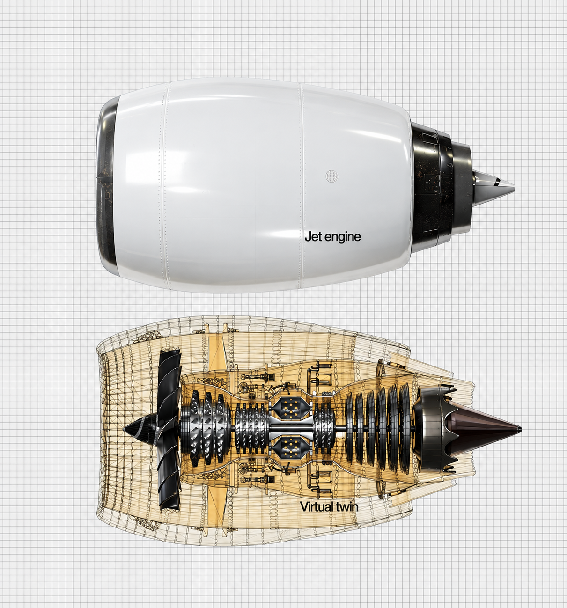
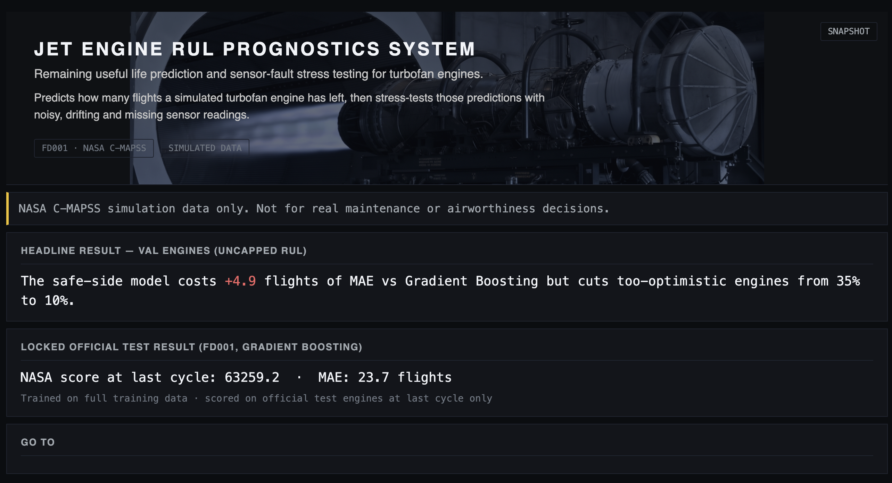
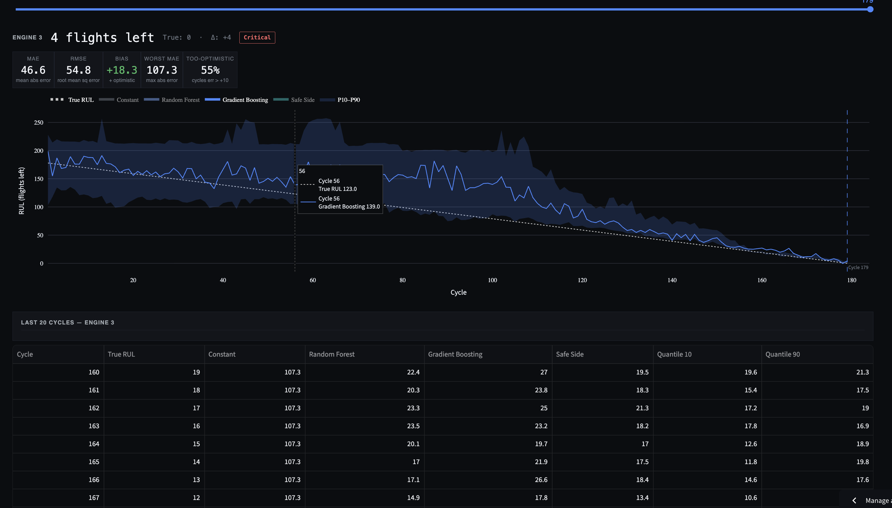
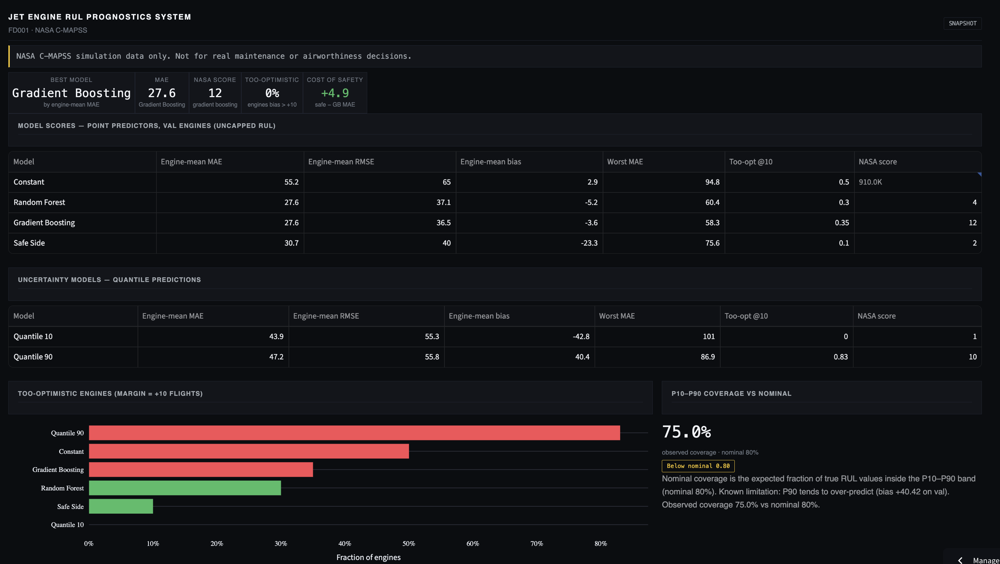
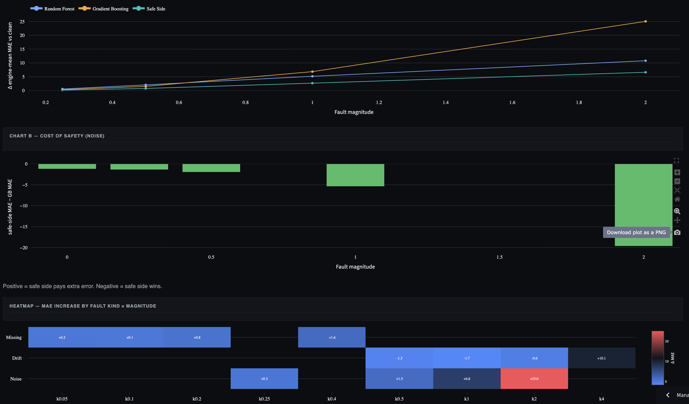
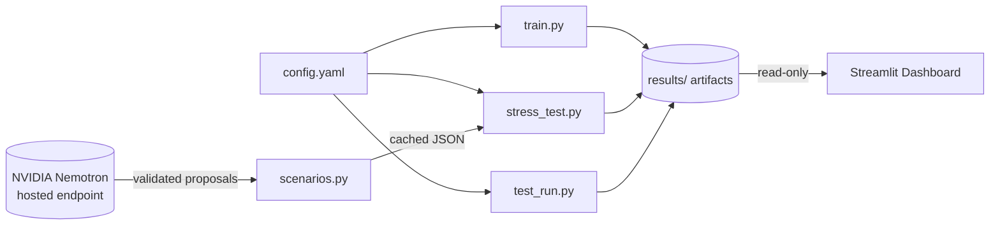

<!-- ============================================================
     HEADER IMAGE
     Save your banner as docs/images/header.png (recommended 1600x400)
     ============================================================ -->
<p align="center">
  
</p>

<h1 align="center">✈️ Jet Engine RUL Prognostics System</h1>

<p align="center">
  <b>Predict how many flights an engine has left, then stress-test that prediction when the sensors go bad.</b>
</p>

<p align="center">
  <a href="https://YOUR-APP.streamlit.app"></a>
  <a href="#-quickstart"></a>
</p>

<p align="center">
  
  
  
  
  
</p>

<p align="center">
  <a href="#-overview">Overview</a> •
  <a href="#-demo">Demo</a> •
  <a href="#-key-results">Results</a> •
  <a href="#-architecture">Architecture</a> •
  <a href="#-quickstart">Quickstart</a> •
  <a href="#-metrics">Metrics</a> •
  <a href="#-repository-layout">Layout</a>
</p>

> [!WARNING]
> **Disclaimer.** This project uses NASA's C-MAPSS *simulation* data, not real airline or engine data. It is a research and portfolio project and **must not** be used for real maintenance or airworthiness decisions.

---

## 🧭 Overview

Maintenance too early wastes money. Maintenance too late risks failure. The dangerous error is predicting **too many flights remaining**.

This project predicts the **Remaining Useful Life (RUL)** of a simulated jet engine, then asks a harder question: **what happens to that prediction when sensors fail?** It measures both the *robustness* of RUL models to sensor faults and the *cost of safety*, the extra early maintenance a cautious model asks for.

### What's inside

| Component | Description |
|---|---|
| 🔮 **Predictor** | Constant baseline, Random Forest, Gradient Boosting, a conservative **safe-side** quantile model (α = 0.30), and P10 / P90 interval models |
| 🧪 **Robustness Lab** | 100 engines are damaged three ways (noise, drift, missing readings) at four magnitudes each, giving 12 grid scenarios × 5 seeds |
| 🤖 **AI scenario generator** | NVIDIA Nemotron proposes extra single-sensor fault settings, strictly validated and cached |
| 📊 **Dashboard** | 4-page Streamlit + Plotly app reading pre-computed artifacts only |

---

## 🎬 Demo


<table>
  <tr>
    <td align="center" width="50%">
      <br>
      <b>Overview</b><br><sub>Headline result and locked official test result</sub>
    </td>
    <td align="center" width="50%">
      <br>
      <b>Engine View</b><br><sub>Predicted vs true RUL with P10–P90 band</sub>
    </td>
  </tr>
  <tr>
    <td align="center" width="50%">
      <br>
      <b>Model Comparison</b><br><sub>MAE, bias, NASA score, cost of safety</sub>
    </td>
    <td align="center" width="50%">
      <br>
      <b>Stress Lab</b><br><sub>Degradation heatmap per fault kind and magnitude</sub>
    </td>
  </tr>
</table>

---

## 🛠️ Tech Stack

<p align="center">
  
  
  
  
  
  
  
  
  
  
</p>

| Layer | Technology | Role |
|---|---|---|
| **Language** | Python 3.11+ | Core pipeline and dashboard |
| **Data** | pandas, NumPy | Loading C-MAPSS, time-series features, evaluation |
| **ML** | scikit-learn | Random Forest, quantile Gradient Boosting (α = 0.30 / 0.10 / 0.90) |
| **AI** | NVIDIA Nemotron-3.5-Lightning | Proposes sensor-fault scenarios via the hosted endpoint at [build.nvidia.com](https://build.nvidia.com) |
| **Dashboard** | Streamlit + Plotly | Four read-only pages rendering pre-computed results |
| **Config** | PyYAML + python-dotenv | All knobs in `config.yaml`; secrets only in `.env` |
| **Quality** | pytest | 94 tests: data splits, metrics, faults, scenarios, dashboard loaders |
| **Hosting** | Streamlit Community Cloud | Auto-redeploys on every push |

---

## 🏗️ Architecture



**Order of operations:** config → offline artifact generation → the dashboard only ever *reads* committed artifacts. No model trains at request time, and no AI call happens on page load.

### 🟢 Where NVIDIA fits

Nemotron-3.5-Lightning (`nvidia/nemotron-3.5-lightning-30b-a3b`, keyed by `NVIDIA_API_KEY`) has **exactly one job**: propose additional single-sensor fault settings to stress.

1. **Calls** the live endpoint once per run (≤ 5 calls, capped by `NEMOTRON_MAX_CALLS`)
2. **Validates** every proposal against a strict schema: sensor whitelist, fault-kind whitelist, per-kind magnitude range, integer seed, dedupe
3. **Unions** validated suggestions with the fixed 12-scenario grid, tagged by provenance (`grid` vs `nemotron`)
4. **Caches** validated replies to `results/nemotron_scenarios.json`, so reruns are deterministic and free

> Nemotron never sees engine data, labels, or scores. It only suggests test scenarios. The live call was executed and verified, and 6 validated settings are cached and committed.

---

## 📈 Key Results

All numbers are computed by `evaluate.py` from artifacts committed under `results/`. Nothing is hand-written. Validation uses a 20-engine seeded holdout from the 100 FD001 training engines, scored against **uncapped** true RUL.

### Validation (20 engines, seed 0)

| Model | Engine-mean MAE ↓ | Mean bias | Too-optimistic engines (bias > +10) ↓ |
|---|:---:|:---:|:---:|
| Constant (baseline) | 55.2 | +2.9 | 50% |
| Random Forest | 27.6 | −5.2 | 30% |
| Gradient Boosting | **27.6** | −3.6 | 35% |
| Safe-side (α = 0.30) | 30.7 | −23.3 | **10%** |

> 🛡️ **Cost of safety: +4.9 flights.** The safe-side model cuts too-optimistic engines from **35% → 10%** at the price of about 5 flights of earlier maintenance.

### Locked official test run

Gradient Boosting trained on the full 100-engine training set, scored once on the official FD001 test engines (100 units) at each engine's **last cycle only**.

| Model | NASA score (last cycle) | MAE |
|---|:---:|:---:|
| Gradient Boosting | 63,259.2 | 23.7 |

### Stress test (clean + 12 grid scenarios × 5 seeds).

- 📉 **Noise hurts most.** At k = 2σ, Gradient Boosting's engine-mean MAE rises by about **+25 flights** over the clean baseline.
- 📈 **Drift can help GB.** Tree models absorb smooth systematic shifts, while the safe-side model pays more there.
- 🩹 **Missing readings barely matter.** Forward-fill handles them.
- 🛡️ **Safety persists.** The safe-side model stays visibly conservative (largest negative bias) under almost all faults, at a measured cost.

---

## 📐 Metrics

**Error convention:** `d = prediction − truth`. Positive `d` means *too many flights left predicted* (optimistic, dangerous).

| Metric | Definition |
|---|---|
| **MAE / RMSE** | Computed per engine, then averaged over engines (per-engine primary, per-flight secondary) |
| **NASA score** | Saxena & Goebel, PHM 2008, at each engine's last cycle: `d < 0 → exp(−d/13) − 1`, `d ≥ 0 → exp(d/10) − 1` (the steeper, dangerous branch) |
| **Too-optimistic rate** | Fraction of rows/engines with `d > +10` flights (margin fixed before runs; 5/10/20 sweep in artifacts) |
| **Cost of safety** | Safe-side MAE − Gradient-Boosting MAE on the same engines |
| **Range calibration** | P10–P90 empirical coverage on validation; quantiles sorted so Q10 ≤ prediction ≤ Q90 |
| **Spread** | Mean ± standard deviation across 5 seeds |

---

## 🖥️ Dashboard Pages

| Page | What it shows |
|---|---|
| **Overview** | Landing page, headline result, locked official test result, links, disclaimer |
| **Engine View** | Pick a validation engine: predicted vs true RUL by flight, GB headline, safe-side comparison, P10–P90 band, per-engine metrics |
| **Model Comparison** | All models side by side: MAE, bias, NASA scores, split tables, cost of safety |
| **Stress Lab** | Degradation per fault kind and magnitude, diverging heatmap (red = worse), cost of safety per fault, grid + Nemotron provenance |

Every page displays: *"NASA C-MAPSS simulation data only. Not for real maintenance or airworthiness decisions."*

---

## ⚡ Quickstart

### 1. Environment

```bash
git clone https://github.com/ameer5511/Jet-Engine-RUL-Prognostics-System.git
cd Jet-Engine-RUL-Prognostics-System

conda create -n rul python=3.11 -y
conda activate rul
pip install -r requirements.txt
```

### 2. Data

Download **NASA C-MAPSS FD001** and place the raw files under `data/raw/` (git-ignored):

```
train_FD001.txt   test_FD001.txt   RUL_FD001.txt   readme.txt
```

Format: whitespace-separated, no header, 26 columns (unit, cycle, 3 operational settings, 21 sensors). 100 train engines (run to failure) and 100 truncated test engines.

### 3. NVIDIA key (for the Robustness Lab)

```bash
cp .env.example .env    # then add your build.nvidia.com key
```

### 4. Generate artifacts

```bash
python train.py          # train all models, evaluate on validation
python stress_test.py    # all models × 12 grid scenarios × 5 seeds
python test_run.py       # single locked run on the official test set
```

### 5. Launch the dashboard

```bash
streamlit run app.py     # → http://localhost:8501
```

### 6. Run the tests

```bash
python -m pytest tests/ -q
```

Tests that need the real FD001 files skip automatically when data is absent, so the suite always runs.

---

## 🗂️ Repository Layout

```text
.
├── app.py                 # Streamlit shell: navigation, sidebar, global styles
├── views/                 # Dashboard pages (Overview, Engine View, Model Comparison, Stress Lab)
├── styles/                # Design tokens + Plotly template
├── dashboard_data.py      # Read-only artifact loaders (Streamlit-cached)
├── config.yaml            # All tunable knobs (paths, seeds, faults, metrics)
├── data.py                # FD001 loading, RUL labels, engine-level split
├── features.py            # Past-only mean/trend features (window resets per engine)
├── models.py              # Constant / RF / GB / quantile models
├── faults.py              # Noise, drift, missing-readings injection
├── scenarios.py           # NVIDIA Nemotron client: prompt → validate → cache
├── train.py               # Fit models, evaluate on validation
├── stress_test.py         # Models × scenarios × seeds
├── test_run.py            # Locked official test run (last-cycle scoring)
├── evaluate.py            # Metrics incl. NASA score at last cycle
├── results/               # Committed artifacts
├── tests/                 # 94 tests, one suite per module
├── docs/                  # Design + UI documentation
├── MASTER_SPEC.md         # Source of truth: design, decisions, acceptance
└── requirements.txt
```

<details>
<summary><b>📦 Committed artifacts (<code>results/</code>)</b></summary>

| File | Contents |
|---|---|
| `phase2_val_predictions.csv` | Per-cycle validation predictions, all models |
| `phase2_metrics.json` | Validation metrics aggregate + resolved config snapshot |
| `phase4_stress.json` / `.csv` | Stress test: clean + 12 scenarios × models × 5 seeds |
| `phase3_test_results.json` | Locked official test result (last-cycle NASA score) |
| `nemotron_scenarios.json` | Live-validated Nemotron fault proposals (6 settings) |

Raw training data (`data/raw/`) and your `.env` are git-ignored.
</details>

---

## 🔒 Reproducibility & Safety

- **Seeds** all live in `config.yaml`, and every run logs the resolved config (`results/phase2_resolved_config.json`).
- **Leak-free split.** Train/validation split is by whole engines, never by row. A test asserts the engine-ID sets are disjoint.
- **Past-only features** with rolling windows reset at each engine boundary.
- **Faults** apply only to held-out data, deterministically per seed. Official test engines are touched exactly once (`test_run.py`).
- **Uncapped RUL targets.** The historical cap of 125 is kept for reference only, so metrics score against the full true range.
- **No maintenance advice** anywhere: README, dashboard header, and every page carry the disclaimer.

---

## 🗺️ Roadmap

| Phase | Description | Status |
|:---:|---|:---:|
| 0 | Setup & spec | ✅ |
| 1 | Data & features | ✅ |
| 2 | Models & baselines | ✅ |
| 3 | Robustness Lab | ✅ |
| 4 | Stress test & evaluation | ✅ |
| 5 | Dashboard & demo | ✅ |
| 6 | Polish, tests, submission | ✅ |

---

## 📚 References

- A. Saxena, K. Goebel, D. Simon, and N. Eklund, *Damage Propagation Modeling for Aircraft Engine Run-to-Failure Simulation*, **PHM 2008** — the C-MAPSS paper and origin of the asymmetric scoring function. ([DOI: 10.1109/PHM.2008.4711414](https://doi.org/10.1109/PHM.2008.4711414))
- F. O. Heimes, *Recurrent Neural Networks for Remaining Useful Life Estimation*, **PHM 2008** — the classic RUL-cap (`censored` target) convention. ([DOI: 10.1109/PHM.2008.4711421](https://doi.org/10.1109/PHM.2008.4711421))
- E. Ramasso and A. Saxena, *Performance Benchmarking and Regularization of prognostics methods*, **IJPHM 2014** — the standard review/benchmark of C-MAPSS methods, incl. "RUL-capping". ([DOI: 10.5014/ijphm.2014.0060](https://doi.org/10.5014/ijphm.2014.0060))
- A. Saxena and K. Goebel, *C-MAPSS Data Set*, NASA Prognostics Center of Excellence (PCoE) — the official dataset source. ([NASA PCoE Data Repository](https://www.nasa.gov/intelligent-systems-division))
- D. A. Beard and H. W. T. van den Broek — *Remaining Useful Life Estimation in prognostics* survey literature, see the Ramasso & Saxena review for a full bibliography.
- **NASA C-MAPSS Reference**: Turbofan Engine Degradation Simulation Data Set, NASA Ames Prognostics Data Repository.
- **NVIDIA Nemotron-3.5-Lightning** model card and hosted endpoint documentation at [build.nvidia.com](https://build.nvidia.com).
- **Streamlit** documentation for `st.navigation` multipage apps and Community Cloud deployment ([docs.streamlit.io](https://docs.streamlit.io)).
- **scikit-learn** quantile regression via `GradientBoostingRegressor(loss="quantile")` ([scikit-learn docs](https://scikit-learn.org/stable/modules/ensemble.html)).
- **Plotly** Python graphing library documentation ([plotly.com/python](https://plotly.com/python/)).

## 📄 License

Released under the **MIT License**. See [LICENSE](LICENSE).

## 👤 Author

**Ameer Muhammed** · [@ameer5511](https://github.com/ameer5511)

<p align="center">
  <sub>If this project helped you, consider giving it a ⭐</sub>
</p>

<p align="center">
  <sub><b>Disclaimer:</b> simulated NASA C-MAPSS data only. Not for real maintenance, airworthiness, or operational decisions.</sub>
</p>
